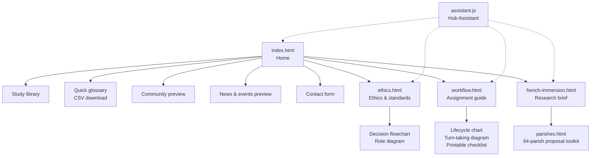
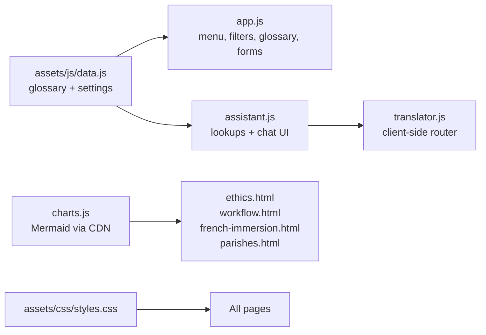
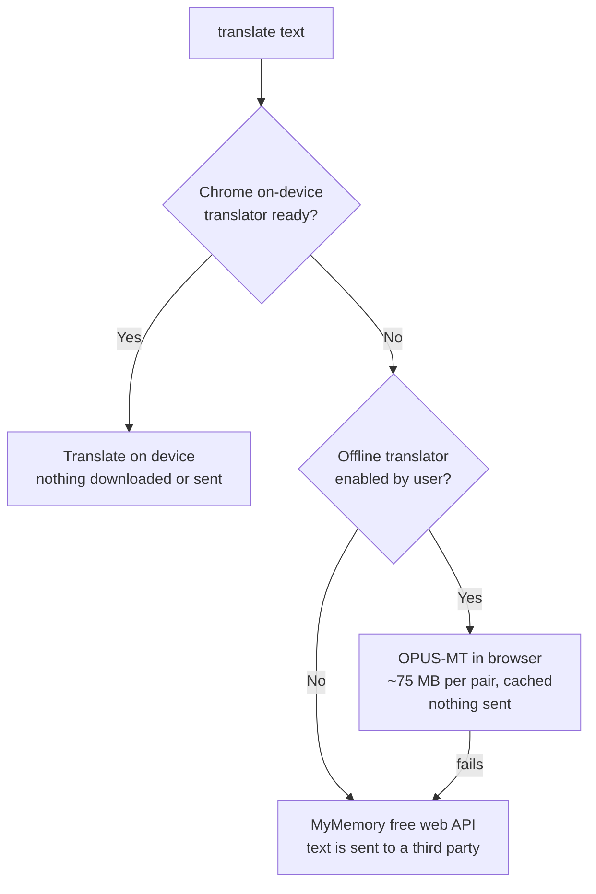

Louisiana Interpreters Hub

Live site: https://wbp318.github.io/LA-Interpreter-Hub-Website-fork/

A professional educational resource center for interpreters, featuring multilingual terminology resources, training materials, industry news, and professional ethics guidelines.

This website is currently under development.

## Pages and sections

- **Study library** (`index.html`) – searchable, filterable resource categories
- **Quick glossary** – English / Spanish / Vietnamese / French starter terms, filterable by setting, with CSV download
- **Ethics & standards** (`ethics.html`) – core principles plus Mermaid decision and role charts
- **Assignment guide** (`workflow.html`) – lifecycle and turn-taking charts, printable pre-assignment checklist
- **French immersion brief** (`french-immersion.html`) – sourced research brief on Louisiana public-school French immersion, with Mermaid charts and per-figure confidence badges
- **Parish proposals** (`parishes.html`) – status table for all 64 parishes and a proposal generator (per parish or all 64 as Markdown); unverified items are marked `[TO VERIFY]`
- **Community** – discussion board preview (sample content only)
- **News & events** – placeholder layout (nothing scheduled or published yet)
- **Contact form** – not connected to an inbox yet; set `contactEmail` in `assets/js/data.js` to enable it
- **Hub Assistant** – built-in helper (`assets/js/assistant.js`) for glossary lookups, navigation, and quick translations

## Site map



## Repo layout

```
index.html, ethics.html, workflow.html,
french-immersion.html, parishes.html    pages
assets/css/styles.css                    shared styles
assets/js/                               data, app, assistant, translator, charts
assets/img/                              banner image
scripts/check.mjs                        site checks run by CI
.github/workflows/ci.yml                 GitHub Actions
```

## How the code fits together



## Translation router

`translator.js` tries each engine in order and tells the user which one answered.



OPUS-MT covers English with Spanish, French, and Vietnamese (both directions) through Transformers.js. Users opt in from the assistant ("enable offline translator").

## Checks

`node scripts/check.mjs` validates JavaScript syntax, local links and anchors, duplicate ids, and the glossary data. GitHub Actions runs it on every push to `main` and on pull requests (`.github/workflows/ci.yml`).

## Notes

- Static site: serve the folder (for example `python -m http.server`) and open `index.html`.
- Glossary data lives in `assets/js/data.js`. Please have fluent speakers verify terms before relying on them.
- Mermaid charts load from the jsDelivr CDN (`assets/js/charts.js`); each has a text alternative.
- The assistant is rule-based, not an LLM. Translations go through the router above: Chrome's on-device translator first, then opt-in OPUS-MT, then the free MyMemory service (text is sent to it). Machine translation is a quick aid, not a certified translation. Do not enter confidential information.
