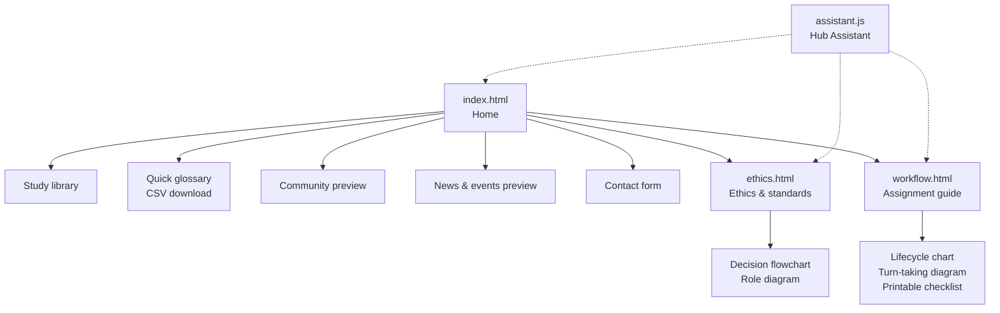
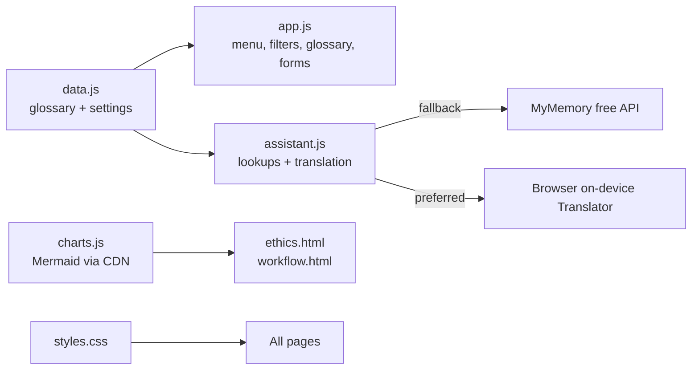

Louisiana Interpreters Hub

A professional educational resource center for interpreters, featuring multilingual terminology resources, training materials, industry news, and professional ethics guidelines.

This website is currently under development.

## Pages and sections

- **Study library** (`index.html`) – searchable, filterable resource categories
- **Quick glossary** – English / Spanish / Vietnamese starter terms, filterable by setting, with CSV download
- **Ethics & standards** (`ethics.html`) – core principles plus Mermaid decision and role charts
- **Assignment guide** (`workflow.html`) – lifecycle and turn-taking charts, printable pre-assignment checklist
- **Community** – discussion board preview (sample content only)
- **News & events** – placeholder layout (nothing scheduled or published yet)
- **Contact form** – not connected to an inbox yet; set `contactEmail` in `data.js` to enable it
- **Hub Assistant** – built-in helper (`assistant.js`) for glossary lookups, navigation, and quick translations

## Site map

## How the code fits together

## Checks

`node scripts/check.mjs` validates JavaScript syntax, local links and anchors, duplicate ids, and the glossary data. GitHub Actions runs it on every push to `main` and on pull requests (`.github/workflows/ci.yml`).

## Notes

- Static site: serve the folder (for example `python -m http.server`) and open `index.html`.
- Glossary data lives in `data.js`. Please have fluent speakers verify terms before relying on them.
- Mermaid charts load from the jsDelivr CDN (`charts.js`); each has a text alternative.
- The assistant is rule-based, not an LLM. Quick translations use the browser's on-device Translator when available, otherwise the free MyMemory service (text is sent to it). Do not enter confidential information.
